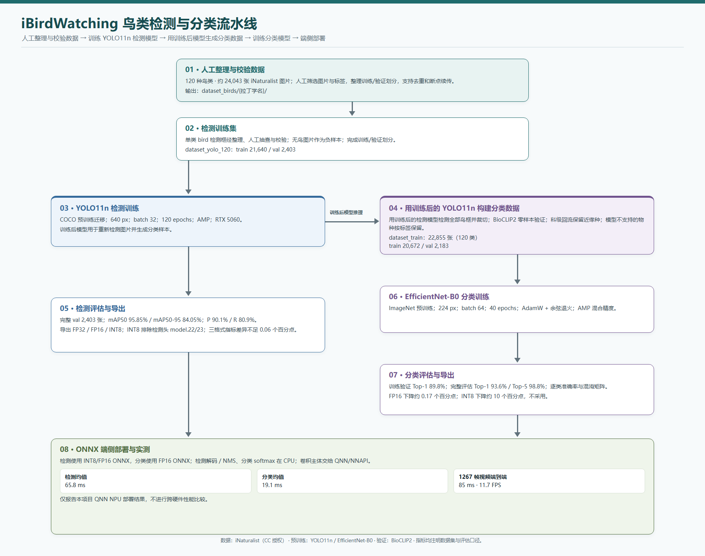
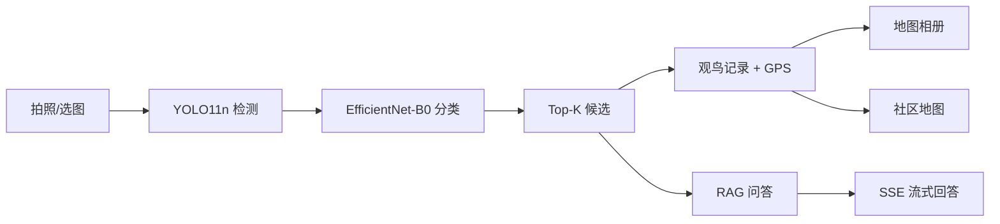
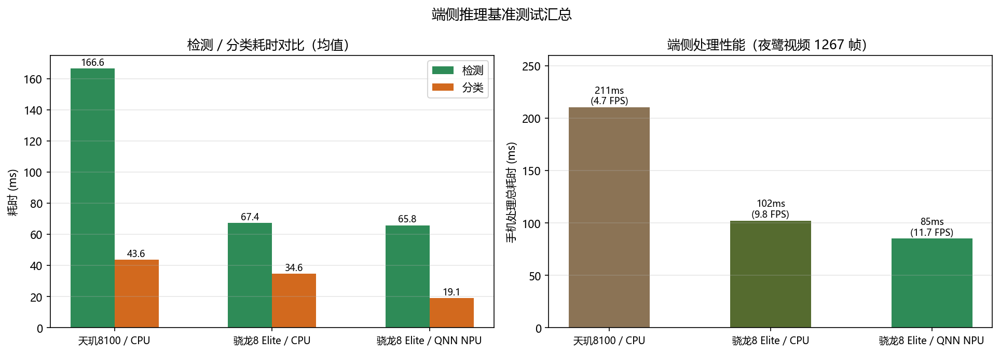

# iBirdWatching 公开展示仓库

这是 iBirdWatching 的脱敏展示版本，用来展示系统架构、核心代码、模型结果和端侧性能。

完整的 Android 客户端、服务端、管理后台、模型和训练数据保留在私有仓库中；本仓库不包含真实密钥、用户数据和大模型文件。

## 项目概述

iBirdWatching 是一个面向观鸟场景的端云协同应用，包含：

- 拍照/选图识别
- 鸟类检测与 120 类分类
- 个人地图相册与社区观鸟地图
- 社区帖子、评论和点赞
- 基于知识库的 RAG 问答
- Vue 管理后台

项目使用 Kotlin/Jetpack Compose 客户端、Spring Boot 服务端、Vue 管理后台，以及 ONNX Runtime 模型推理。

## 技术栈

| 层 | 技术 |
| --- | --- |
| 移动端 | Kotlin、Jetpack Compose、ONNX Runtime、osmdroid |
| 服务端 | Java 17、Spring Boot、JPA/MySQL、Spring Security、JWT |
| 管理后台 | Vue 3、Element Plus、ECharts |
| 模型 | YOLO11n、EfficientNet-B0、ONNX、FP16/INT8 量化 |
| 问答 | BGE 嵌入、知识库检索、DeepSeek SSE 流式输出 |

## 系统链路

## 模型结果

| 模型 | 结果 |
| --- | --- |
| YOLO11n 检测 | mAP50 95.85%，mAP50-95 84.05% |
| EfficientNet-B0 分类 | 120 类，完整评估 Top-1 93.6%，Top-5 98.8% |
| 端侧部署 | FP32 / FP16 / INT8 ONNX |

训练日志中的验证集 Top-1 为 89.8%；93.6% 是完整评估结果，两个数字口径不同。

### 端到端性能

测试视频共 1267 帧：

| 环境 | 检测均值 | 分类均值 | 端到端 | 帧率 |
| --- | ---: | ---: | ---: | ---: |
| QNN NPU | 65.8 ms | 19.1 ms | 85 ms | 11.7 FPS |

## Android 离线 Demo

`releases/iBirdWatching-demo.apk` 是一个可安装的离线检测 + 分类 demo：

- Android 12 及以上
- 相机拍照和系统相册选图
- YOLO 检测 + EfficientNet-B0 120 类分类
- 使用 FP32 ONNX 模型，完全离线运行
- 不包含登录、地图和 RAG

安装说明和校验值见 [releases/README.md](releases/README.md)。

## 登录、注册和地图网关怎么公开

公开仓库不直接提交真实服务密钥。展示版采用“适配器 + demo 模式”：

### 登录和注册

- 注册接口只写入 demo 数据库，不依赖第三方账号。
- 密码使用 BCrypt 哈希存储。
- 登录返回 JWT access token，刷新接口签发新 token。
- `JWT_SECRET` 必须由环境变量提供；公开示例只保留占位符。
- demo 模式可以预置一个测试账号，便于招聘方查看流程。

### 地图网关

- 业务代码只依赖 `MapTileProvider` 接口。
- 默认使用 `MockMapTileProvider`，返回本地占位瓦片，不依赖外网。
- 生产适配器读取 `TIANDITU_TK` 环境变量；没有配置时不会发起真实请求。
- 客户端永远不直接持有天地图密钥，瓦片请求统一经过服务端鉴权和缓存。

### RAG 和 DeepSeek

- 默认使用 `LocalKnowledgeProvider`，从示例知识库返回内容。
- 只有配置 `DEEPSEEK_API_KEY` 时才启用真实模型。
- 未配置密钥时返回本地知识片段，避免公开仓库依赖第三方服务。

详细说明见 [docs/demo-mode.md](docs/demo-mode.md)。

## 代码摘录

本目录只保留脱敏后的代表性代码，不是完整可编译工程：

- [JWT 认证过滤器](samples/JwtAuthFilter.java)
- [认证 Controller](samples/AuthController.java)
- [识别服务](samples/RecognitionService.java)
- [地图代理 Controller](samples/ProxyController.java)
- [地图瓦片接口](samples/MapTileProvider.java)
- [Mock 地图适配器](samples/MockMapTileProvider.java)
- [天地图适配器示意](samples/TiandituTileProvider.java)
- [RAG 流式问答 Controller](samples/ChatController.java)

完整运行代码和移动端工程不公开；面试时可提供受限代码走读。

## 公开与私有边界

| 公开内容 | 私有内容 |
| --- | --- |
| 架构、接口设计、性能结果 | 完整业务源码 |
| 少量脱敏代码摘录 | 用户数据、上传图片、数据库数据 |
| 配置模板 | 数据库密码、JWT secret、OSS/天地图/DeepSeek 密钥 |
| 训练和推理指标 | 完整模型权重、训练数据集 |

模型权重可以放到 GitHub Releases 或对象存储，不放进普通 Git 历史。

## 面试讲法

1. 先讲“检测 + 分类”的两阶段架构，以及为什么移动端要做 NPU 适配。
2. 再讲 JWT 认证和服务端代理如何避免密钥落到客户端。
3. 最后讲 RAG 的检索、SSE 流式输出和模型不可用时的降级。

不要声称这是完整生产系统；明确说明完整工程私有，本仓库是可审查的展示层。
